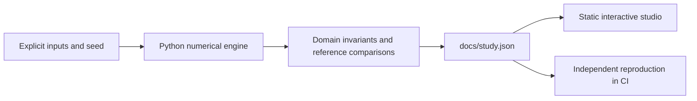

# Quantum Decision Studio

Constrained allocation and variational correlated-electron research.

**[Open the interactive research studio](https://fyodoramanov1.github.io/quantum-optimization-lab/)** · [Measured study](docs/study.json) · [Technical case study](reports/applied-study.md) · [Source](src/studio.py)

Build useful constrained decision tools and correlated-electron experiments, with exact references and honest implementation costs.

## What you can do

- **Constrained allocation:** Eight synthetic assets, exactly three holdings, turnover costs and correlated risk. Compare a number-preserving quantum ansatz with exhaustive enumeration and classical local search.
- **Correlated electrons:** A spinful two-site Hubbard dimer isolates the competition between electron hopping and on-site repulsion. A symmetry-preserving variational state is checked against exact and analytic ground-state energies.

The interface selects recorded experiments, toggles chart series and exports the comparison table. Each view includes the method, assumptions, provenance and its reproduce command. No API key is required. Market Replay additionally plays the actual book snapshots; the Evidence Observatory performs local retrieval and numeric-claim checks.

## Reproduce

Python 3.12; CPU only. From this repository:

```powershell
python -m pip install -r requirements.txt
python src/studio.py --out docs/study.json
python -m http.server 8000 --directory docs
```

Open `http://localhost:8000`. The static app fetches its local JSON, so use HTTP rather than opening `index.html` directly. No JavaScript build step or package installation is needed.

CI reproduces every applied case with `python src/studio.py --check docs/study.json`, checks numerical invariants and retains the original independent numerical contract. New applied code lives under `src/`; `lab.py` and its original CLI remain compatible for the existing research milestones.

## Recorded findings

### Constrained allocation

- Exact minimum cost: **-0.0382941 **
- QAOA expected cost: **-0.0307853 **
- Optimal-sample probability: **10.5287 %**
- Feasible configurations: **56 **

### Correlated electrons

- Maximum energy error: **5.55112e-16 t**
- Spin orbitals: **4 **
- Sector dimension: **4 **
- Double occupancy at U/t=8: **0.0527864 **

## Design



`src/common.py` defines the compact study schema and tolerant cross-platform reproduction check (relative tolerance 2e-4, absolute 2e-6). Domain checks use tighter tolerances where appropriate. `quality/contract.py` is a committed independent contract snapshot, protected from the daily generator; public CI does not need access to a private controller.

## Scientific boundaries

Explicit synthetic financial parameters and a defined effective Hamiltonian. CPU statevector calculations; no quantum hardware calls.

- Synthetic forward-looking means/covariance: no historical backtest or investment claim. Small exact simulation is the reference, not evidence of scalability.
- Mixer construction and dense exponentiation operate in a constrained subspace; physical preparation, compiled gates and measurement overhead are not benchmarked.
- Uniform probability mixing is a sensitivity model, not calibrated gate noise. Both expected objective and success probability must be inspected.
- This is an effective correlated-electron benchmark, not an ab initio molecule or a battery-material prediction. It is a foundation for extending the battery-design theme.
- The ansatz can span this tiny real sector; success does not demonstrate a scalable chemistry algorithm.
- No finite-shot Pauli measurement, molecular geometry, basis-set error, device noise or battery voltage is represented.

## Next research questions

- Add finite-shot observable measurement to the Hubbard VQE, with measurement grouping and uncertainty.
- Compare constrained ansatz depths and classical solvers at matched objective-evaluation budgets.
- Extend the effective electron model and assess when the restricted ansatz fails; do not relabel toy energies as battery properties.

## References

- [Quantum alternating operator ansatz](https://arxiv.org/abs/1709.03489)
- [Variational quantum eigensolver](https://arxiv.org/abs/1304.3061)
- [Battery-design inspiration: EnergetiQ](https://github.com/FyodorAmanov1/EnergetiQ)

## Development history

AI-assisted implementation. The original baseline and milestone reports are preserved under `reports/`; the applied study is a separate artifact. Results are measured simulations, not claims of live profitability, quantum advantage or independent research novelty. MIT license.
